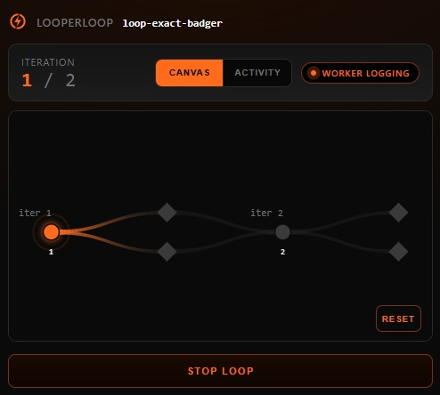
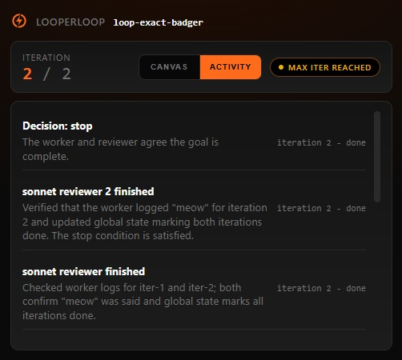

<h1 align="center">Looper Loop</h1>

<p align="center">
  <strong>Agentic loop that works and gets the job done</strong>
</p>

<p align="center">
  <a href="https://bun.sh/"></a>
  <a href="https://www.typescriptlang.org/"></a>
  <a href="https://modelcontextprotocol.io/"></a>
  <a href="https://opensource.org/licenses/MIT"></a>
</p>

`looperloop` runs a coding agent in a detached loop with observer agents. When both worker and observer agree the job is done - loop ends.

Every iteration of worker agent is a new conversation (which is actually great for token efficiency), in the end agent reports as "done" or "continue", its work is being reviewed by observer agents, to ensure nothing is missed.
This relentless process is repeated until worker and all observers align on completion of the task (or are blocked on it).

The agent flow is using **Memento** pattern, which makes it leave notes as handoff document for the next iteration.

<p align="center">
  &nbsp;
  
</p>

---

## Quick Start

### Install the Claude Code plugin

Add it directly from Claude Code marketplace:

```text
/plugin marketplace add Altair200333/looperloop
/plugin install looperloop@looperloop
/reload-plugins
```

After that, start a loop from Claude Code:

```text
/looperloop fix the failing snapshot tests -c "max 5, opus agent, gpt reviewer"
```

Claude Code will call the plugin MCP server, return a loop id, and open a small status page for that specific run. 
When the loop finishes, ask Claude for the result - it will present the user-facing summary first.

---

## Features

| Feature | Details |
|---------|---------|
| Multi-provider | Worker and observers can each use Claude CLI or Codex CLI with configurable effort |
| Detached runs | Loop state is file-based and survives editor restarts |
| Multiple observers | Several reviewers can judge the same iteration |
| Status UI | Local browser page with live status and **graph** view |
| Notifications | Optional sound, toast, Telegram, and Slack messages on start and finish |

---

## How It Works

Each normal iteration has two phases: the worker acts, then observers review. Their verdicts are merged into one decision: continue, done, dispute, or cancel.

```text
+----------------+      +----------------+      +----------------+      +----------------+
| worker         | ---> | observers      | ---> | verdict merge  | ---> | next iter      |
| Claude/Codex   |      | Claude/Codex   |      | continue/done  |      | or stop        |
+----------------+      +----------------+      +----------------+      +----------------+
```

The driver runs as its own process. The MCP server starts it, then reads state files from disk. If your editor session restarts, the loop directory still contains the prompts, worker logs, observer reviews, verdicts, branch graph, and final result.

Run data lives under this path in the workspace where Claude spawned it:

```text
./looper/loop-runs/<loop-id>/
```

---

## Usage

### Slash command config

```text
/looperloop <task> -c "<natural-language config>"
```

Examples:

```text
-c "max 3, opus agent, opus reviewer"
-c "max 3, sonnet agent, opus reviewer"
-c "max 3, gpt-5.5 agent, opus reviewer"
-c "max 1, gpt-5.5 agent low effort, sonnet reviewer low effort"
```

`agent` and `worker` mean the same thing. `reviewer`, `judge`, and `observer` mean the same thing.

### Status and results

During a run, the browser page shows:

- current iteration and status
- worker and observer activity summaries
- graph/canvas view of the main loop and side branches
- stop button for cancellation

After a run completes, the important entry point is `looperloop_result`. It returns the final user-facing result, the result file path, the run directory, and pointers to detailed logs if you want to inspect what happened.

### Notifications

Register notification targets once; they are stored globally on your machine, not inside each project.

You can tell Claude Code something like:

```text
Use looperloop to register Telegram notifications with this bot token and chat id: ...
```

or:

```text
Use looperloop to register Slack DM notifications for me with this bot token and my email: ...
```

The plugin can also test, enable, or disable registered notification channels.
