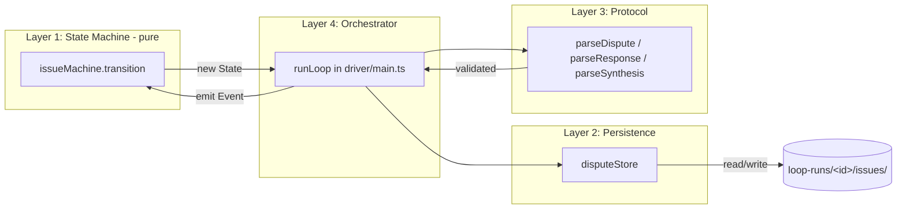
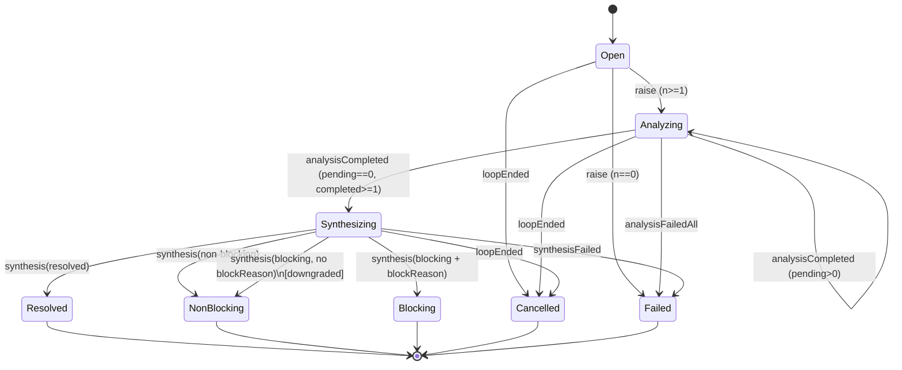
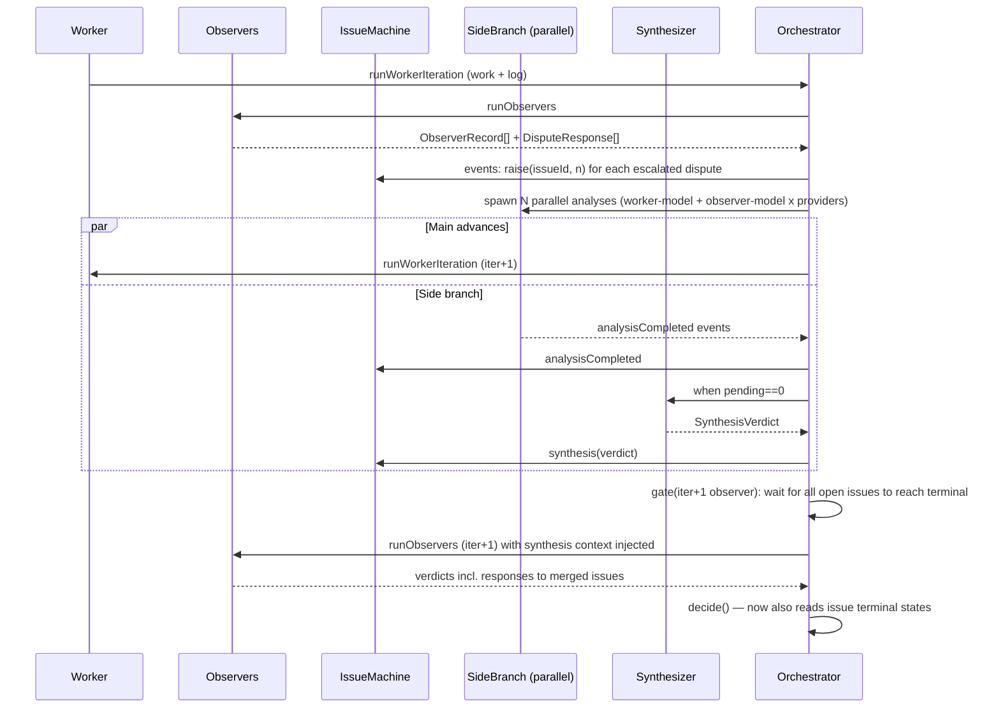

# Branching Dispute Resolution Plan

## 1. Motivation (grounded in loop-happy-tiger)

LooperLoop today has no way to record a *structured disagreement* between the
worker and the observer. The observer can only return one of:

```ts
// driver/runners/types.ts
enum ObserverVerdict { Done, Continue, Abort, Failed }
```

…and the worker can only return:

```ts
// driver/runners/types.ts
enum WorkerSignal { Done, Abort, None }
```

Those collapse to one of:

```ts
// driver/runners/types.ts
enum FinalDecision { Done = "DONE", Continue = "CONTINUE", Abort = "ABORT" }
```

via `decide(...)` in `driver/main.ts` and `mergeObserverVerdicts(...)` in
`driver/observers.ts`. There is no `escalate`, no `needs-user`, no "agree to
disagree" — the only worker→observer back-channel is **prose written into
`global-state.md`** (see `driver/prompt.ts:buildObserverPrompt`, which reads
`globalStatePath(loopDir)` from `driver/state.ts`).

### What loop-happy-tiger showed

In the `loop-happy-tiger` run, observer iter-7 / iter-8 flagged the
`CODE_STYLE.md` "Dates: luxon `DateTime`" rule. The worker's position was
defensible (no `luxon` dep, no `@regie/universal`, no UI/date semantics in a
zero-dep Bun MCP server) and was eventually accepted across iterations 7–9.
But the loop could not *close* the disagreement:

- The worker wrote a "Procedural deadlock note" in `global-state.md`
  ("observer iter-7 / iter-8 want explicit user approval to mark this rule
  out-of-scope; the loop alone cannot resolve this without violating the
  task's 'do not add features' constraint").
- The observer kept returning `Continue` because there was no verdict that
  meant *"I cannot independently approve this exception, but it does not
  block the requested task — escalate to the human."*
- The disagreement was carried forward only as English prose in
  `global-state.md`, with no machine-readable handle for the orchestrator,
  the next observer, or `looperloop_result`.

The loop burned iterations re-litigating the same point. That is the
specific failure mode this plan fixes.

### Goal

Make disagreements **first-class, structured, machine-readable artifacts**
that can be:

1. raised by the worker without the worker having to win,
2. acknowledged by the observer without the observer having to approve,
3. analyzed in parallel on a side branch while the main loop keeps moving,
4. carried into the final `looperloop_result` as either *open questions*
   (non-blocking) or a `needs-user` terminal status (blocking).

Most disputes should **not** stop the loop. They should land in
`RESULT.json` as open questions if the main task can still progress.

### Non-goals (scope guard)

- No full DAG scheduler yet. This plan now includes a small generic branch
  layer (`driver/branches/*`) so dispute branches and future research
  branches can share node/result/graph concepts without turning the loop
  into a general workflow engine.
- No new RPC surface beyond what `mcp/server.ts` already exposes.
- No change to runner contracts (`driver/runners/registry.ts`, claude-cli /
  codex-cli stay untouched).
- No retroactive change to existing `verdicts.json` files (only additive
  fields).

## 2. Mental Model

Think of the loop like a main git branch.

The worker and observer move on `main`. When a disputed point appears,
LooperLoop opens a short side branch ("issue branch") to analyze it. The
side branch runs several agents in parallel (worker-model and observer-model
analyses across all configured providers), then a synthesis observer
collapses them into one verdict. The main branch is allowed to advance by
one worker iteration while the side branch is running.

```text
main:              A---B---C-----------M---D
                       \               /
issue-branch:           X---Y---Z-----'

A = iter N worker
B = iter N observer raises a structured Dispute
C = iter N+1 worker continues safe work (may resolve issue incidentally)
X = parallel worker-model analyses of the issue
Y = parallel observer-model analyses of the issue
Z = synthesis observer verdict
M = synthesis verdict merged into iter N+1 observer prompt
D = CONTINUE | DONE | NEEDS_USER | ABORT
```

The loop does **not** stop at `B`. It only stops at `D`, and only if the
synthesis verdict is `blocking` with a non-empty `blockReason`.

## 3. Architecture: Four Independent Layers

The user's stated preference is a graph system engine with a robust state
machine that is easy to test for all reachable states. We decompose into
four layers, each unit-testable in isolation:

```text
+-----------------------------------------------------------+
| Layer 4: Orchestrator       (driver/main.ts extensions)   |
|   - drives transitions, schedules side branches,          |
|     detects deadlocks, decides terminal status            |
+-----------------------------------------------------------+
| Layer 3: Negotiation Protocol  (driver/dispute/protocol)  |
|   - Dispute / DisputeResponse / SynthesisVerdict shapes   |
|   - parsers + validators (e.g. blocking ⇒ blockReason)    |
+-----------------------------------------------------------+
| Layer 2: Persistence            (driver/dispute/store)    |
|   - state ↔ disputes.json, issues/<id>/*, verdicts.json   |
|   - extends driver/state.ts; reuses iterDir, globalStatePath|
+-----------------------------------------------------------+
| Layer 1: State Machine          (driver/dispute/machine)  |
|   - pure: (State, Event) -> State, no I/O                 |
|   - enumerable Issue states + transitions                 |
+-----------------------------------------------------------+
```

Layer 1 has zero I/O and no imports outside `runners/types.ts`. Layer 2 is
the only layer that touches the filesystem. Layer 3 is pure data shapes +
parsers (no I/O). Layer 4 wires it all into `runLoop` in
`driver/main.ts`.



## 4. Layer 1 — Issue State Machine (pure, fully enumerable)

### 4.1 States

```ts
// driver/dispute/machine.ts
export enum IssueState {
  Open          = "open",          // raised this iteration, no analyses started
  Analyzing     = "analyzing",     // parallel analyses dispatched, awaiting all
  Synthesizing  = "synthesizing",  // analyses done, synthesis observer running
  Resolved      = "resolved",      // synthesis says: incidentally fixed
  NonBlocking   = "non-blocking",  // carry to final result as open question
  Blocking      = "blocking",      // synthesis says: needs user
  Cancelled     = "cancelled",     // loop ended before synthesis; archive only
  Failed        = "failed",        // analysis or synthesis crashed irrecoverably
}
```

Terminal states: `Resolved`, `NonBlocking`, `Blocking`, `Cancelled`,
`Failed`. (5 terminal, 3 transient.)

### 4.2 Events

```ts
export type IssueEvent =
  | { kind: "raise"; analyses: number }       // Open  -> Analyzing (analyses>=1)
  | { kind: "analysisCompleted" }             // Analyzing -> Analyzing | Synthesizing
  | { kind: "analysisFailed" }                // Analyzing -> Analyzing | Synthesizing | Failed
  | { kind: "analysisFailedAll" }             // Analyzing -> Failed only when no analysis succeeded or remains pending
  | { kind: "synthesis"; verdict: SynthesisVerdict } // Synthesizing -> {Resolved|NonBlocking|Blocking}
  | { kind: "synthesisFailed" }               // Synthesizing -> Failed
  | { kind: "loopEnded" };                    // any non-terminal -> Cancelled
```

### 4.3 Transition table (complete, enumerable)

| From            | Event                            | Guard                                 | To              |
|-----------------|----------------------------------|---------------------------------------|-----------------|
| Open            | raise                            | analyses >= 1                         | Analyzing       |
| Open            | raise                            | analyses == 0                         | Failed          |
| Analyzing       | analysisCompleted                | pending > 0                           | Analyzing       |
| Analyzing       | analysisCompleted                | pending == 0 && completed >= 1        | Synthesizing    |
| Analyzing       | analysisFailed                   | pending > 0                           | Analyzing       |
| Analyzing       | analysisFailed                   | pending == 0 && completed >= 1        | Synthesizing    |
| Analyzing       | analysisFailed                   | pending == 0 && completed == 0        | Failed          |
| Analyzing       | analysisFailedAll                | completed == 0 && pending == 0        | Failed          |
| Analyzing       | analysisFailedAll                | completed > 0 \|\| pending > 0        | Analyzing (ignored with warning) |
| Synthesizing    | synthesis                        | verdict.kind == "resolved"            | Resolved        |
| Synthesizing    | synthesis                        | verdict.kind == "non-blocking"        | NonBlocking     |
| Synthesizing    | synthesis                        | verdict.kind == "blocking" && blockReason | Blocking    |
| Synthesizing    | synthesis                        | verdict.kind == "blocking" && !blockReason | NonBlocking (downgraded; see §6.3) |
| Synthesizing    | synthesisFailed                  | —                                     | Failed          |
| {Open,Analyzing,Synthesizing} | loopEnded         | —                                     | Cancelled       |
| any terminal    | any                              | —                                     | (no-op, return same state) |



### 4.4 Reachability test (acceptance criterion)

Because states are an `enum` and events are a small discriminated union, the
machine is fully enumerable. The unit test enumerates every `(state,event)`
pair, asserts the transition matches the table, and confirms every terminal
state is reachable from `Open` along at least one event sequence. This is
what "easy to test for all reachable states" means in practice.

## 5. Layer 2 — Persistence (extends existing layout)

### 5.1 Existing files (unchanged)

From `driver/paths.ts` and `driver/state.ts`:

```text
loop-runs/<loop-id>/
  state.json            # LoopState (driver/state.ts)
  global-state.md       # globalStatePath() — worker-authored prose
  config.json           # LoopConfig (driver/state.ts)
  RESULT.json           # written on terminal status
  iter-<K>/
    worker.log.md
    observer-iter-<K>-<N>-<model>.md
    verdicts.json       # Verdicts (driver/state.ts)
    worker.turn*.jsonl  # raw runner streams
```

### 5.2 New files (additive only)

```text
loop-runs/<loop-id>/
  disputes.json                    # registry: id -> { state, openedIter, ... }
  issues/
    issue-<NNN>/
      issue.md                     # human-readable summary of the dispute
      dispute.json                 # canonical Dispute (Layer 3 shape)
      analysis-<role>-<provider>-<model>.md   # one per analysis node
      analysis-<role>-<provider>-<model>.raw.jsonl
      synthesis.md
      synthesis.json               # canonical SynthesisVerdict
  iter-<K>/
    disputed-flags.md              # only if worker raised disputes this iter
```

### 5.3 Extensions to existing types

Strictly additive — old runs keep parsing.

```ts
// driver/state.ts (new fields, all optional)
export type Verdicts = {
  worker: WorkerSignal;
  workerAbortReason?: string;
  observers: ObserverRecord[];
  merged: ObserverVerdict;
  final: FinalDecision;
  // NEW:
  disputesRaised?: string[];       // issue IDs opened this iteration
  disputesMerged?: string[];       // issue IDs whose synthesis was injected
};

export enum LoopStatus {
  // ...existing...
  // NEW:
  AnalyzingDispute = "analyzing-dispute",
  NeedsUser        = "needs-user",     // new terminal
}

export enum ActivityStage {
  // ...existing...
  // NEW:
  IssueOpened     = "issue-opened",
  IssueAnalyzing  = "issue-analyzing",
  IssueSynthesis  = "issue-synthesis",
}
```

### 5.4 Tradeoff: where do disputes live?

| Option                                             | Pros                                              | Cons                                                            |
|----------------------------------------------------|---------------------------------------------------|-----------------------------------------------------------------|
| A. Inline inside `verdicts.json` per iteration     | One file, already loaded by `driver/prompt.ts`    | Cross-iteration disputes (multi-iter analysis) get awkward      |
| B. Separate `disputes.json` + `issues/<id>/` tree  | Clean lifecycle, parallel writes safe, UI-friendly| New top-level concept                                           |
| C. Append-only event log                           | Reproducible, easy to replay                      | Heavier; needs a reducer                                        |

**Recommendation: B.** Issues outlive an iteration; B keeps that lifecycle
explicit. `verdicts.json` only references issue IDs (`disputesRaised`,
`disputesMerged`). The state machine is the reducer; no separate event log
needed yet.

### 5.5 New module surface

```ts
// driver/dispute/store.ts — only layer that touches FS for issues
export interface DisputeStore {
  list(): Promise<IssueRecord[]>;
  get(id: string): Promise<IssueRecord | undefined>;
  create(input: CreateIssueInput): Promise<IssueRecord>;
  recordAnalysis(id: string, file: AnalysisFile): Promise<IssueRecord>;
  recordSynthesis(id: string, verdict: SynthesisVerdict): Promise<IssueRecord>;
  cancelOpen(): Promise<IssueRecord[]>;     // on loopEnded
}
```

Implemented on top of the same `enqueueStateWrite` queue used by
`appendActivity` / `updateState` in `driver/state.ts` so concurrent writes
from parallel side-branch runners stay serialized per-loop.

## 6. Layer 3 — Negotiation Protocol

The whole point is to remove "prose in `global-state.md`" as the only
back-channel. The protocol layer defines exact message shapes and the
parsers that produce them; nothing in this layer touches the filesystem or
spawns subprocesses.

### 6.1 Worker → observer: `Dispute`

The worker writes a structured flag (one entry per disputed point) to
`iter-<K>/disputed-flags.md` instead of free-form prose.

```ts
// driver/dispute/protocol.ts
export type Dispute = {
  flag: string;                    // canonical short name, e.g. "Dates rule requires luxon"
  raisedInIter: number;
  workerPosition: string;          // <= ~500 chars
  proposedResolution:
    | "scope_exception"
    | "non_applicable"
    | "needs_user_decision"
    | "fix_in_followup";
  evidence: string[];              // bulleted, machine-readable references
};
```

Sentinel + parser modeled on `parseObserverVerdict` /
`parseWorkerSignal` already in `driver/runners/sentinels.ts`. The worker
log-turn prompt (`driver/prompt.ts:buildWorkerLogPrompt`) is extended to
mention `disputed-flags.md` as an optional output.

### 6.2 Observer → orchestrator: `DisputeResponse`

Observer responds to each `Dispute` from the previous iteration in the
observer markdown (`observer-iter-<K>-<N>-<model>.md`), in a fenced YAML
block parsed by an additive parser:

```ts
export type DisputeResponse = {
  flag: string;                    // matches Dispute.flag
  observerPosition: string;
  escalate: boolean;               // request side branch
  blocking: boolean;               // would block main if synthesis confirms
  reason: string;
  blockReason?: string;            // REQUIRED when blocking == true
  recommendedResolution:
    | "resolved"
    | "continue_with_instruction"
    | "carry_to_result"
    | "ask_user";
};
```

Crucially, this gives the observer the verdict it currently lacks:
`escalate: true, blocking: false`. That alone resolves the loop-happy-tiger
deadlock — the observer can record "I cannot independently approve the
luxon scope exception, but it does not block the task" without forcing
`Continue` forever.

### 6.3 Synthesis observer → orchestrator: `SynthesisVerdict`

```ts
export type SynthesisVerdict = {
  issueId: string;
  kind: "resolved" | "non-blocking" | "blocking";
  reason: string;
  blockReason?: string;            // REQUIRED iff kind == "blocking"
  recommendedInstructionForWorker?: string;
  userQuestion?: string;           // surfaces in needs-user terminal
};
```

**Validation rule (Layer 3):**

```ts
export function validateSynthesis(v: SynthesisVerdict): SynthesisVerdict {
  if (v.kind === "blocking" && !v.blockReason?.trim()) {
    // Defensive downgrade: an under-specified blocker must not hard-stop the
    // loop. Layer 1 transitions to NonBlocking on this case; Layer 4 logs
    // a warning into LoopState.warnings.
    return { ...v, kind: "non-blocking" };
  }
  return v;
}
```

This is the same defense-in-depth the original draft proposed, now
attributed to a layer with a single responsibility.

## 7. Layer 4 — Orchestrator (extensions to `driver/main.ts`)

The existing `runLoop` flow per iteration is:

```text
worker work turn -> worker log turn -> observers -> mergeObserverVerdicts -> decide -> writeJson(verdicts.json)
```

The new flow inserts dispute handling *between* the observer step and the
`decide` step, and runs the side-branch in parallel with the *next* worker
turn.

### 7.1 Extended per-iteration flow



### 7.2 Decision rule (extends `decide` in `driver/main.ts`)

Existing `decide` returns `FinalDecision`. The extended decision considers
`IssueState` of all merged issues for the iteration:

```ts
function decideExtended(params: DecideParams & { mergedIssues: IssueRecord[] }): FinalDecision | "NEEDS_USER" {
  // 1. Existing rules first (stop, max-iter, observer Abort, all Done, etc.)
  const base = decide(params);
  if (base === FinalDecision.Done || base === FinalDecision.Abort) return base;
  // 2. If any merged issue is Blocking, terminal status is NEEDS_USER.
  if (params.mergedIssues.some(i => i.state === IssueState.Blocking)) return "NEEDS_USER";
  // 3. Otherwise CONTINUE; non-blocking/resolved issues just ride along.
  return FinalDecision.Continue;
}
```

`NEEDS_USER` maps 1:1 to a new `LoopStatus.NeedsUser` terminal state, with
`RESULT.json.outcome = "needs-user"` and the synthesis `userQuestion`
surfaced in `userFacingResult` (see §8).

### 7.3 Deadlock detection (the actual loop-happy-tiger fix)

The orchestrator detects a procedural deadlock — same flag re-raised across
≥ 2 consecutive observer iterations without explicit escalation and with no
synthesis verdict yet — and force-promotes it to a side branch even if no
observer set `escalate`. Algorithm:

```ts
// per-iteration, after observers run
for (const flag of seenFlags) {
  const history = observerHistory.responsesFor(flag);
  if (history.length >= 2 && history.every(r => !r.escalate) && !store.hasIssueFor(flag)) {
    // Two iterations of the same un-escalated dispute => deadlock; open issue ourselves.
    store.create({ flag, source: "deadlock-detector", ... });
  }
}
```

This guarantees that a procedural deadlock cannot persist silently in
`global-state.md` prose for more than one extra iteration — which is the
exact symptom we saw in iter-7/iter-8 of `loop-happy-tiger`.

### 7.4 Concurrency budget

- Side-branch analyses run in parallel via `Promise.all`, mirroring
  `runObservers` in `driver/observers.ts`.
- One main-loop iteration is allowed to run *concurrently with* the side
  branch, but iter `K+2`'s observer step **awaits** all open issues raised
  in iter `K`. This bounds the depth of in-flight side branches to 1.
- If a side branch is still running when the loop hits `maxIter`, the
  orchestrator emits `loopEnded`; Layer 1 transitions the issue to
  `Cancelled` and the side branch's processes are aborted via the existing
  `makeAbortContext` in `driver/run-helpers.ts`.

### 7.5 Observer prompt extension

`driver/prompt.ts:buildObserverPrompt` is extended to inject:

```text
## Dispute synthesis (from previous iteration)
- issue id, original flag, recommended resolution, blocking?, blockReason?
- one-line summary per analysis file (paths only; observer can read on demand)
```

This is the observer's view of the merged side branch — it replaces what
the loop-happy-tiger worker had to smuggle in via prose in
`global-state.md`.

## 8. Result Contract Change (`mcp/tools/result.ts`)

The current `ResultOutput` (see `mcp/tools/result.ts`) has
`userFacingResult: string` plus `files.iterations[*]`. We add issue
outcomes:

```ts
// mcp/tools/result.ts (additive)
export type ResultOutput = {
  // ...existing fields...
  outcome: "done" | "max-iter-reached" | "aborted" | "cancelled" | "failed" | "needs-user";
  openQuestions?: Array<{
    issueId: string;
    flag: string;
    state: "non-blocking" | "blocking" | "resolved" | "cancelled" | "failed";
    summary: string;
    blockReason?: string;
    userQuestion?: string;
    files: { issue: string; synthesis?: string; analyses: string[] };
  }>;
  branchGraph: {
    nodes: Array<{ id: string; kind: string; branchKind: string; status: string; label: string; file?: string }>;
    edges: Array<{ from: string; to: string; kind: "spawns" | "feeds" }>;
  };
};
```

- `state == "non-blocking"` → carried into `userFacingResult` as a
  bulleted "Open questions" section.
- `state == "blocking"` → loop terminated as `needs-user`; `userQuestion`
  is the lead text of `userFacingResult`.

`RESULT_INSTRUCTION` is updated so the calling agent reads
`openQuestions[*].userQuestion` first when `outcome === "needs-user"` and
uses `branchGraph` when it needs to explain or render parallel side work.

## 8.1 Generic Branch Layer

Dispute branches are now backed by a small generic branch surface:

```text
driver/branches/
  parallel.ts   # run N independent branch nodes in parallel
  graph.ts      # project branch nodes/edges for status/result/canvas views
```

This is deliberately smaller than a full graph engine. It gives future
branch types, such as independent research agents, the same core shape:

```text
Branch
  -> parallel node A
  -> parallel node B
  -> parallel node C
  -> optional synthesis/result node
```

The dispute implementation remains the first concrete branch type. A future
research branch should add a `BranchKind.Research` producer and reuse
`runParallelBranch(...)` for the parallel research nodes, then expose those
nodes through the same `branchGraph` result field.

## 9. Worked Scenarios (mapped to the state machine)

### 9.1 Reviewer is right (no dispute)

`Dispute` not raised. State machine never instantiated.
Existing path through `decide`. No change.

### 9.2 The luxon case (loop-happy-tiger)

```text
iter-7 worker: writes Dispute{flag:"Dates rule requires luxon", proposed:"non_applicable", evidence:[no dep, no UI]}
iter-7 observer: DisputeResponse{escalate:true, blocking:false, recommendedResolution:"carry_to_result"}
   IssueMachine: Open --raise(n=4)--> Analyzing
iter-8 worker: continues unrelated work (main branch advances)
   side branch: 4 analyses complete --> Synthesizing
   synthesis: {kind:"non-blocking", reason:"no luxon dep, rule N/A to zero-dep MCP server"}
   IssueMachine: Synthesizing --synthesis--> NonBlocking
iter-8 observer: receives synthesis context, returns Continue (or Done)
final RESULT.json.outcome = "done", openQuestions = [{state:"non-blocking", flag:"Dates rule requires luxon", ...}]
```

### 9.3 Real blocker (incompatible migration)

```text
iter-N worker: Dispute{proposed:"needs_user_decision"}
iter-N observer: DisputeResponse{escalate:true, blocking:true, blockReason:"public API divergence"}
   side branch synthesis: {kind:"blocking", blockReason:"...", userQuestion:"preserve compat or remove legacy?"}
   IssueMachine: Synthesizing --synthesis--> Blocking
iter-N+1 observer: sees blocking issue --> decideExtended returns NEEDS_USER
LoopStatus = NeedsUser, RESULT.outcome = "needs-user", userFacingResult leads with userQuestion
```

### 9.4 Self-resolves

Worker's iter-N+1 work incidentally fixes the disputed condition. Synthesis
returns `{kind:"resolved"}`. IssueMachine → `Resolved`. No appearance in
`openQuestions`.

### 9.5 Under-specified blocker (defense-in-depth)

Synthesis returns `{kind:"blocking"}` with empty `blockReason`.
`validateSynthesis` (§6.3) downgrades to `non-blocking`; Layer 4 records a
warning in `LoopState.warnings`. Loop does not hard-stop.

## 10. Test Strategy (one matrix per layer)

| Layer            | Test target                                         | Strategy                                                       |
|------------------|-----------------------------------------------------|----------------------------------------------------------------|
| 1 State Machine  | `transition(state, event) -> state`                 | Enumerate all (state,event) pairs; assert against §4.3 table   |
| 1 State Machine  | reachability                                        | BFS from `Open`; assert every terminal is reachable            |
| 2 Persistence    | `DisputeStore` round-trip                           | Temp dir per test; create/recordAnalysis/recordSynthesis       |
| 2 Persistence    | concurrency                                         | Two parallel writes hit the same `enqueueStateWrite` queue     |
| 3 Protocol       | `parseDispute / parseResponse / parseSynthesis`     | Golden-file parse; reject malformed; downgrade rule (§6.3)     |
| 4 Orchestrator   | `decideExtended`                                    | Property test: existing `decide` outputs preserved when no issues|
| 4 Orchestrator   | deadlock detector                                   | Synthetic 3-iter history with same un-escalated flag           |
| 4 Orchestrator   | side-branch concurrency bound                       | Inject fake runners; assert iter K+2 observers wait on issues  |

Layers 1 and 3 are pure and run with no FS. Layer 2 uses a temp loop dir.
Only Layer 4's tests need the runner registry (mockable via
`createDefaultRunnerRegistry` already used by existing tests in
`tests/driver/`).

## 11. Why this design fits looperloop

- **No new RPC.** `looperloop_start / status / result / cancel / list /
  tail / logs` keep their schemas; only `result.ts` adds optional fields.
- **No new runner abstraction.** Side-branch agents are the same
  `claude-cli` / `codex-cli` runners invoked through the existing
  registry, with `AgentRole.Worker` / `AgentRole.Observer` and
  `TurnKind.Observe`.
- **No churn to `verdicts.json`.** Existing fields preserved verbatim;
  `disputesRaised` / `disputesMerged` are optional ID arrays.
- **Same state-write discipline.** The new `DisputeStore` reuses
  `enqueueStateWrite` from `driver/state.ts` so we keep one serialization
  point per loop.
- **UI-ready.** A future status-window can render
  `disputes.json` + `issues/<id>/` as branches without backend changes —
  the data is already structured.

## 12. Open design questions (surfaced, not silently picked)

1. **Where is the dispute parser invoked?**
   (a) inside the existing observer parser in `driver/runners/sentinels.ts`,
   or (b) as a separate post-processing pass in `driver/observers.ts`.
   *Recommendation:* (b) — keeps `sentinels.ts` focused on terminal
   sentinel detection.
2. **Does the side branch see the workspace at iter-N or iter-N+1?**
   The side branch should snapshot at iter-N (the iteration the dispute
   was raised against) so analyses are not contaminated by iter-N+1's
   incidental edits. Implementation: pass the iter-N HEAD ref / read-only
   `iterDir(root, N)` and forbid writes outside `issues/<id>/`. Tradeoff
   noted; concrete enforcement can be a Layer 4 follow-up.
3. **How many parallel analyses per issue?**
   Default to one worker-model + one observer-model per *configured*
   `ModelRef` in `LoopConfig` (so a 1-worker-1-observer setup spawns 2
   analyses; a 3-provider setup spawns 6). Cap via a config knob
   `LoopConfig.disputes?.maxAnalysesPerIssue` (default 6).
4. **Should `disputed-flags.md` be required or optional?**
   *Recommendation:* optional, parsed only if present. The worker prompt
   mentions it; absence simply means "no disputes this iteration", which
   matches the no-op path in §9.1.

## 13. Summary

```text
Worker articulates a structured Dispute.
Observer responds with a structured DisputeResponse (now with escalate).
Orchestrator opens an Issue; state machine drives Open → Analyzing → Synthesizing.
Side branch runs analyses in parallel while main advances one step.
Synthesis verdict lands the Issue in Resolved / NonBlocking / Blocking.
Main loop continues unless a Blocking issue exists, in which case the loop
terminates as needs-user, with a structured open question in RESULT.json.
```

Acceptance for this plan (mapped to the task's stop conditions):

1. Idea + motivation grounded in the loop-happy-tiger luxon deadlock → §1.
2. At least one diagram → mermaid state diagram (§4.3) and component +
   sequence diagrams (§3, §7.1); ASCII git-branch sketch (§2).
3. Independent testable layers → §3 (4 layers), §10 (per-layer tests).
4. Fits existing repo → cites `driver/runners/types.ts`,
   `driver/state.ts`, `driver/observers.ts`, `driver/main.ts`,
   `driver/prompt.ts`, `driver/paths.ts`, `mcp/tools/result.ts`,
   `driver/run-helpers.ts`, `driver/runners/sentinels.ts` with no new
   special cases.
5. Enumerable states + transitions → §4.1 (enum), §4.3 (full table),
   §4.4 (reachability test).
