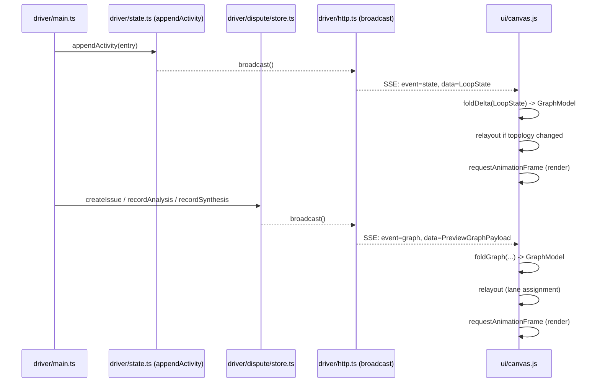

# Preview Window -- Canvas Graph View (HLD + LLD)

Status: design only. No code changes in this doc.
Owner: preview/UI surface.
Related: `docs/plans/branching-dispute-resolution.md` (dispute branching model
this view must render).

---

## 0. TL;DR

The preview window today shows a single "Activity Feed" list backed by
`/state` (Server-Sent Events from `driver/http.ts`). This plan adds a second
view -- a **Canvas Graph** that lays out iterations and roles like a git
history graph, with disputes drawn as branch-offs that merge back into the
review they originated from.

A rectangular two-segment toggle (Activity | Canvas) switches between the
two, matching the existing black/orange theme (`--bg #0a0a0a`,
`--accent #ff6b1a`).

Activity stays the default. The two views are siblings in the existing
`<main>` and share the same `LoopState` stream -- only one is rendered at a
time.

The view is feasible against the current data model **with four concrete,
small additive surfaces**: extended `ActivityEntry`, a new preview-specific
`/graph` DTO route, dispute origin/analysis identity metadata on issue
records, and an `onMutate` broadcast hook threaded through the dispute store
and analysis runner. These are additive; none break existing consumers.
See Section 5.2.A-D.

---

## 1. Goals & non-goals

**Goals**

1. A second view of the live loop that conveys structure (iterations,
   roles, parallel branches) rather than just a chronological list.
2. Match `docs/plans/branching-dispute-resolution.md` -- disputes appear as
   branch-offs that merge back into the iteration's review.
3. Live updates from the existing SSE channel; no new transport.
4. Pure browser implementation, no build step, no new runtime deps
   (current UI is hand-written JS in `ui/app.js`).

**Non-goals**

- No editing of loop state from the canvas (read-only, like Activity).
- No timeline scrubbing / replay.
- No zoom in v1 (pan + reset only -- see Section 3.1 for rationale).
- No export (PNG/SVG dump).
- Not a general DAG editor; layout is specialised to looperloop's shape.

---

## 2. UI control -- view toggle

A single rectangular pill, divided in the middle, lives in the existing
`<section class="card iter-card">` row of `ui/index.html` (the row that
already hosts `#statusPill`, see `ui/index.html:269-275`). The toggle
is right-aligned in that card, immediately before `#statusPill`. The
top `<header>` keeps just the logo + loop id; placing the toggle there
would crowd the brand row and break the existing visual weight.

The card already uses `display: flex; justify-content: space-between`,
so the toggle slots in by adding it as a child between the iteration
counter and the status pill -- no layout rewrite needed.

```
+--------------+--------+
|  ACTIVITY    | CANVAS |
+--------------+--------+
```

- Two `<button role="tab">` elements wrapped in
  `<div role="tablist" class="view-toggle">`.
- The active segment uses `background: var(--accent); color: #0a0a0a;`
  (the same inversion already used by `button#stop:hover`).
- The inactive segment uses `background: transparent; color: var(--muted);`
  with `border: 1px solid var(--border)`.
- Divider is a 1px `var(--border)` between segments.
- Persist selection in `localStorage["preview.view"]` so reload keeps the
  user's choice. Default: `"activity"`.

CSS lives in the existing `<style>` block in `ui/index.html`. No external
stylesheet -- that matches the project's "no build step" stance.

Keyboard: `<-`/`->` move focus between the two tabs (standard ARIA tablist
behaviour). `Enter`/`Space` activates.

---

## 3. Canvas Graph view

### 3.1 Visual language

```
Iteration 1   Iteration 2   Iteration 3
   o--------------o--------------o           workers (circle)
   |              |              |
   D              D              D           observers (diamond)
                                 |
                                 +-D-+       dispute analyses (diamond)
                                 |   |
                                 +-d-+       synthesis (open diamond)
                                 |
                                 D           merged review
```

- **Workers** = filled circle (`r = 8px`). Stage-1 (`worker-work`) and
  stage-2 (`worker-log`) are merged into a single worker node per
  iteration; the log step is treated as a continuation of work, not a
  separate node, because the user-perceived event is "the worker
  iterated".
- **Observers / reviewers / judges** = filled diamond (`8px` half-diagonal).
  One diamond per `ObserverRecord` in `verdicts.json` for that iteration
  (i.e., one per configured `observers[]` model). For now there is no
  separate "judge" role in the codebase, so the same shape is used for
  any reviewer-style agent; if a `judge` role is added later it inherits
  the diamond.
- **Dispute analyses** = smaller filled diamond (`6px`) on the side
  branch. There is one per `IssueRecord.analysisNodes[*]`.
- **Synthesis** = open (stroked, not filled) diamond at the merge point of
  the dispute branch, mapping to `IssueRecord.synthesis`.
- **Currently-running worker**: pulse animation (see Section 6.4) -- the same
  shimmer accent already used in `.activity li[data-live="true"]
  .activity-stage` (`#d6a083` / `#ffe2cc`).
- **Currently-running observer or analysis**: same pulse, scaled down.
- **Failed node** (`ActivityStatus.Failed`, `ObserverVerdict.Failed`,
  `IssueAnalysisRecord.status === "failed"`): solid `var(--danger)
  #ef4444` outline ring.
- **Cancelled / aborted**: `var(--muted) #737373` fill, no pulse.

Edges. **Backend `BranchGraphEdge` semantics** (verified against
`driver/branches/graph.ts:106,120`):
- `kind: "spawns"` connects the per-issue **branch node** (`kind:
  "branch"`) to each of its analysis nodes -- i.e. branch -> analysis,
  one edge per analysis. *Not* observer -> analysis.
- `kind: "feeds"` connects each analysis node to the synthesis node --
  i.e. analysis -> synthesis, one edge per analysis. *Not* synthesis
  -> next-iter observer.

The canvas therefore draws **six visual edge classes**, of which only
two come straight from `branchGraph` and four are renderer-derived:

| Visual edge                       | Source                                                        |
|-----------------------------------|---------------------------------------------------------------|
| trunk: worker(N) -> worker(N+1)    | derived from `LoopState.activity` ordering                    |
| review: worker(N) -> observer-K(N) | derived from `ActivityStage.Observer` entries in iter N       |
| spawn-fan: branch -> analyses      | direct from `branchGraph.edges` where `kind === "spawns"`     |
| feed-fan: analyses -> synthesis    | direct from `branchGraph.edges` where `kind === "feeds"`      |
| resolution arc: synthesis -> review-N | renderer-derived, see Section 3.3 (needs new `originObserverIndex` field) |
| forward feed: synthesis -> observer-1(N+1) | renderer-derived, modelled on dispute-plan Section 7.1 data flow |

Trunk + review edges are 2px / 1.5px solid `var(--accent)`. Spawn-fan
and feed-fan edges are 1.5px solid `var(--accent)` at 70% alpha
(internal to the dispute lane). The resolution arc is solid in the
iteration colour. The forward feed is dashed at 50% alpha. Visual
weight differs so the eye reads the trunk first, then the review
drops, then the dispute lane internals, then the cross-iteration
edges last.

### 3.2 Iteration colour palette

The black background (`--bg #0a0a0a`) and orange accent (`--accent #ff6b1a`)
constrain palette choice. Avoid hue rotation -- multi-hue palettes break the
"orange theme" promise and one of the standard categorical palettes
(category10, tableau) clashes with `#ef4444` and `#22c55e` already used
for danger/ok states.

Use an **orange luminance ramp** keyed off iteration index:

| Iter (mod 6) | Hex      | OKLCH approx        | Use |
|--------------|----------|---------------------|-----|
| 0            | `#ff6b1a`| L 0.72 C 0.20 H 45  | base accent |
| 1            | `#ffa264`| L 0.79 C 0.13 H 50  | lighter |
| 2            | `#c2541a`| L 0.58 C 0.16 H 45  | deeper |
| 3            | `#ffd1a8`| L 0.88 C 0.07 H 55  | pale |
| 4            | `#8a3a13`| L 0.43 C 0.12 H 40  | umber |
| 5            | `#ffbe85`| L 0.83 C 0.11 H 52  | sand |

Why this works on `#0a0a0a`:
- All six entries have OKLCH lightness >= 0.43, well above the background
  (~= 0.04). Minimum contrast ratio ~= 5.8:1 (umber `#8a3a13`), comfortably
  above WCAG AA non-text 3:1 for graphics.
- All six share hue ~= 40-55 deg. The eye reads them as "the same family",
  preserving theme integrity. They differ by lightness/chroma, which is
  the channel humans discriminate most reliably on dark backgrounds.
- Palette wraps at 6 because beyond that the perceptual gaps shrink to
  the point of confusion. Default `LoopConfig.maxIter` is commonly >=10,
  so wrap is the realistic case, not the edge case. To prevent two
  on-screen iterations sharing a colour from being mistaken for the
  same iteration:
  - Every worker node carries a small numeric iteration badge (white
    `#fafafa`, 9px monospace, drawn inside or just below the circle).
    The badge is the disambiguator after wrap.
  - Iteration column guideline labels at the top of the canvas show the
    iteration number too.

  We deliberately do **not** extend the ramp past 6: lightness headroom
  exists, but adding more pale entries reduces the perceptual distance
  between *adjacent* entries, which is the discrimination that matters
  most. Numeric badges are a more robust disambiguator than fragile
  near-isoluminant hues.

The iteration colour applies to:
- The worker node fill.
- The observer-diamond outline (fill stays accent for visual hierarchy).
- The vertical "iteration column" guideline at 25% opacity.

Status colours (`var(--danger)`, `var(--ok)`, `var(--warn)`, `var(--muted)`)
**override** iteration colour on the affected node so failure/cancel
remains legible.

### 3.3 Dispute visualisation (mapping to branching-dispute-resolution.md)

Reference: `docs/plans/branching-dispute-resolution.md` Section 3 (4 layers),
Section 7.1 (sequence diagram), Section 8.1 (generic branch surface), Section 5.5
(`DisputeStore`).

The dispute model produces, per issue:
- One `IssueRecord` (id `issue-N`) created when an observer escalates a
  dispute (`source: "observer"`) or when the deadlock detector fires
  (`source: "deadlock-detector"`).
- N `IssueAnalysisRecord` parallel analyses (worker-model + observer-model
  x providers, default cap 6).
- Optionally one `SynthesisVerdict` once all analyses complete.
- A state machine (`IssueState`: Open -> Analyzing -> Synthesizing -> one of
  Resolved / NonBlocking / Blocking / Cancelled / Failed).

Visualisation rule: **the branch-off point is the observer node that
raised the dispute, and the synthesis merges back into that same
review while also feeding forward.** Two edges leave the synthesis:

1. A **resolution arc** (solid, iteration-coloured) loops back to the
   originating review-N diamond. This is the "merge back into the
   corresponding review" the task requires -- it makes the dispute
   lifecycle per-review legible at a glance and matches the git-graph
   metaphor of a side branch merging back into its parent.
2. A **forward "feeds" edge** (dashed) into the *next iteration's*
   observer column. This mirrors the data flow in
   `docs/plans/branching-dispute-resolution.md` Section 7.1, where synthesis
   context is actually injected into the iter N+1 observer prompt.

The two edges encode different things -- the arc encodes "this review's
dispute is now resolved", the dashed feed encodes "and the next review
saw the synthesis". Drawing both keeps the visualisation faithful to
*both* the task's wording (merges back into the review) and the actual
data-flow contract from the dispute plan. Either edge alone would
mislead.

```
iter N            iter N+1
                     observer of N+1
   o                    D
   |                  / |
   D -- spawns --+  /   |           D = review (observer)
   ^ - resolves -+DDD   |           DDD = dispute analyses
   |              v  feeds          d = synthesis (open diamond)
   |              v     |
   |             d------+
   |             |
   |             +-- arc --+         resolution arc (solid, iter colour)
   +-----------------<-----+         loops back into review N
```

The "spawns" (branch->analysis) and "feeds" (analysis->synthesis) edges
come straight from `BranchGraphEdge.kind` in `branches/graph.ts`.

The resolution arc and the forward feed are renderer-side
constructs. The arc needs to know **which observer raised the
dispute** so it can land on the right diamond when an iteration has
multiple observers. Today this information is **not persisted**:
`DisputeResponse` (`driver/dispute/protocol.ts:29-36`) has only
`flag`, `observerPosition`, `escalate`, `blocking`, `reason`,
`blockReason`, `recommendedResolution` -- no observer identity.
`IssueRecord.responses[]` (`driver/dispute/store.ts:52`) inherits
this gap.

**This is a required additive backend change** (see Section 5.2.C). Add
either:
- `IssueRecord.originObserverIndex: number` (0-based index into
  `config.observers[]`), populated in `driver/main.ts` at the call
  to `createIssue(...)` from the dispute-response loop (`driver/main.ts`
  around line 481, `openIssueForResponse(response, source)`). The
  observer index needs to be plumbed in from the surrounding
  observer iteration if it isn't already in scope -- verify in
  iteration before implementing, since the current call signature
  takes only `(response, source)` and doesn't carry observer
  identity. If escalation collection lives elsewhere (see
  `driver/observers.ts`), the field is plumbed at that boundary
  instead. Either way the change is mechanical: the value exists
  upstream, we just don't pass it down today, or
- `IssueRecord.originObserverId: string` (the `ObserverRecord.id`
  string -- preferred for forward-compat if observer ordering ever
  changes mid-run, but `index` is sufficient for v1 and is what the
  canvas actually needs to pick the right diamond by column).

For deadlock-detector-sourced issues (`source ===
IssueSource.DeadlockDetector`), `originObserverIndex` is `undefined`
and the resolution arc lands on a synthetic "deadlock anchor" point
between the last observer of iter N and the spine of iter N+1 (drawn
as a small empty marker, never persisted, label "deadlock detector").
The dispute plan `Section 3` (4 layers) treats deadlock-detector and
observer-escalation symmetrically, but the canvas needs *some* anchor
for the arc -- the synthetic anchor is the smallest visual concession.

If the issue terminates as `Blocking`, the synthesis diamond is outlined
in `var(--danger)`. **The trunk does not terminate at the synthesis.**
The synthesis is consumed by the *next* iteration's loop pass: per
`driver/main.ts:358,425-430,436-447,448`, iter N+1's worker has already
run before pending issue branches are awaited; the synthesis is then
appended as an `IssueSynthesis` activity in iter N+1, observers run
(`driver/main.ts:448`), and only after that does the driver decide
`NeedsUser` (`driver/main.ts:577`). The canvas therefore renders
iter N+1's worker, observers, and decision/needs-user terminus
normally -- the trunk stops at iter N+1's terminal node, **not** at
`raisedInIter` (= N). This also matches `docs/plans/branching-dispute-resolution.md:99-103`
where C is iter N+1 worker and M is synthesis merged into iter N+1's
observer prompt. If `NonBlocking`, the synthesis is filled with
`var(--warn) #eab308` and the trunk continues normally past N+1. If
`Resolved`, regular accent.

This is exactly the structure already produced by `branches/graph.ts`:
`BranchGraphNode { kind: "branch" | "analysis" | "synthesis" }` and
`BranchGraphEdge { kind: "spawns" | "feeds" }`. The renderer consumes
`BranchGraph` directly -- no parallel data construction.

`IssueSource.DeadlockDetector` issues are visually identical to observer-
sourced ones except the "spawns" edge originates from a *gap* between the
observer and the next worker (not from a specific observer diamond), and
the edge label tooltip reads "deadlock detector" instead of an observer
id.

---

## 4. Interactions

### 4.1 Pan

- Pointer down on canvas background -> pointer move translates `viewX,
  viewY` by drag delta. Pointer up commits.
- Touch: same, single-finger drag.
- During an active pan drag, `autoFollow` is set to `false`.

### 4.2 Reset view button

- Floating button bottom-right of the canvas, styled identically to
  `button#stop` (uppercase, monospace, accent border on hover).
- On click: animate `viewX, viewY, zoom=1` back to the "fit-currently-
  working-node" framing over 250ms (ease-out cubic), then re-engage
  `autoFollow = true`.

### 4.3 Auto-follow

- Default state on view mount: `autoFollow = true`.
- Each frame: compute `targetX, targetY` to keep the
  *currently-working* node centred horizontally and 60% down vertically
  (so future iterations have headroom above for the dispute branch
  fan-out).
- When `autoFollow` is true, ease `viewX, viewY` toward target at
  `lerp(0.12)` per frame.
- "Currently-working node" derived from `LoopState.currentActor` and
  `LoopState.status`. Actor strings verified against current source
  (`driver/worker.ts:116,179`, `driver/observers.ts:37`,
  `driver/main.ts:398,562`, `driver/dispute/analysis.ts:223`,
  `driver/http.ts:45`):

  Auto-follow is **not** a pure function of `state.currentActor`.
  Dispute branches launched by `runIssueBranch()` continue running
  concurrently with the main loop after a single
  `currentActor: \`issue.${issueId}\`` write at branch start
  (`driver/dispute/analysis.ts:223`). The main loop then advances
  through `deciding` (`driver/main.ts:561`,
  `currentActor: "driver"`) and into the next iteration's
  `worker.turn1` (`driver/worker.ts:116`) **while the side
  branch is still alive**. So `state.currentActor` may point at a
  main-trunk worker even when one or more issue branches are
  still running. The durable running signal is
  `IssueRecord.state` from `/graph.issues[]` (the field is
  `state`, not `status`; values are the `IssueState` enum from
  `driver/dispute/machine.ts:1` -- running <=>
  `!isTerminalIssueState(state)` <=> state is `Analyzing` or
  `Synthesizing`).

  **Auto-follow priority** (highest first):

  1. If `state.status` is a terminal status, auto-follow turns
     off and the camera last-centres on the final trunk node.
  2. If `state.currentActor` starts with `issue.`, parse
     `<issueId>` from the suffix and follow that issue's open
     synthesis placeholder (or its newest still-running analysis
     diamond if no synthesis placeholder has been created yet --
     see Section 5.3 for placeholder derivation). This is the
     "branch-just-launched" window, before the main loop moves
     on.
  3. Otherwise, look up `/graph.issues[]` for any issues with
     `!isTerminalIssueState(state)` (i.e. `Analyzing` or
     `Synthesizing`). If exactly one is running, follow its
     open analysis/synthesis cluster. If multiple are running
     (parallel branches), follow the one with the **highest
     `id`** (issue ids are zero-padded `issue-NNN` and lexically
     ordered, so the highest id is the most recently created;
     see `nextIssueId` in `driver/dispute/store.ts:126-136`).
     This is the "main-loop-has-moved-on-but-branches-still-running"
     window.
  4. Otherwise, dispatch on `state.currentActor` / `state.status`
     for trunk nodes:

     | currentActor             | status              | follows                                |
     |--------------------------|---------------------|----------------------------------------|
     | `worker.turn1`           | worker-running      | worker node of `state.iter`            |
     | `worker.turn2`           | worker-logging      | worker node of `state.iter`            |
     | `observers`              | observers-running   | last observer diamond of `state.iter`  |
     | `cancelling`             | cancelling          | worker node of `state.iter` (no pulse) |
     | `driver` / undef         | deciding            | last observer diamond of `state.iter`  |

  The diamond pulse on still-running issue branches is independent
  of which one auto-follow is centred on: every issue with
  `!isTerminalIssueState(state)` pulses, with `Synthesizing` =>
  the synthesis-placeholder pulses (analyses idle), and
  `Analyzing` => the still-pending analysis diamonds pulse
  (synthesis placeholder idle). Auto-follow only chooses the
  camera target.

  The driver phase identified by `currentActor: "driver"` is
  the post-observer decision point only (deciding /
  needs-user / done resolution); the analyzing-dispute phase is
  emphatically *not* one of them. This corrects an earlier
  draft that conflated the two, and the iter-5 draft that
  treated the rare `currentActor: \`issue.${issueId}\`` write
  as a sufficient signal -- it is a transient hint, not the
  source of truth.

- Disengage triggers: any pan drag (pointerdown + move on canvas
  background). Wheel events do nothing in v1 because zoom is disabled
  -- explicitly *do not* disengage on wheel, to avoid surprise
  disengagement from incidental scrolling.
- Re-engage trigger: pressing Reset.

### 4.4 Hover tooltip

A single floating `<div>` reused across hovers (created once on mount,
pinned to body, repositioned by transform).

Fields per node kind, derived from current data:

**Worker node** (per iteration):
- `Role: worker`
- `Iteration: N / maxIter`
- `Status: running | done | failed | cancelled`
- `Started: <ActivityEntry.startedAt>` -- **new optional field** added in
  Section 5.2.A. Today only `ActivityStage.WorkerLog` is appended
  (`driver/main.ts:367-370`); the `WorkerWork` enum value
  (`driver/state.ts:31`) is never produced. This tooltip row therefore
  appears only after Section 5.2.A's `startedAt` field is populated by the
  producer at the point worker turn 1 begins (set in
  `driver/worker.ts` around line 116 where `currentActor` flips to
  `worker.turn1`). Until then, render `Started: --`.
- `Updated: <ActivityEntry.updatedAt>`
- `Model: <worker.provider>/<worker.model>  -  effort=<worker.effort>`
  -- sourced from the `worker` field of `/graph` (Section 5.2.B). This
  field is therefore available immediately on canvas mount,
  *before* any `ActivityEntry` for the worker has been appended
  by `driver/main.ts:367-370`, so pre-completion worker nodes
  still render a model row. If the canvas was loaded against an
  old run that pre-dates Section 5.2.B, `worker` is absent from
  `/graph` -- fall back to `ActivityEntry.model` (added in
  Section 5.2.A) when present, or render `Model: --` otherwise.
- `Title: <ActivityEntry.title>`
- `Summary: <ActivityEntry.summary>` (if present)

**Observer diamond**:
- `Role: observer`
- `Iteration: N`
- `Observer: <ObserverRecord.id>` (e.g. `observer-1`)
- `Status: <ActivityStatus> + ObserverVerdict`
- `Verdict: done | continue | abort | failed`
- `Model: <observers[i].provider>/<observers[i].model>  -  effort=<observers[i].effort>`
  -- sourced from the `observers` array of `/graph` (Section 5.2.B),
  indexed by `observerId` once the activity entry exists, or by
  positional index for the placeholder diamonds the canvas paints
  while observers are still running. Same fallback chain as the
  worker tooltip (`ActivityEntry.model` -> `--`).
- `File: <ObserverRecord.markdownPath>` (relative to loop dir)
- `Updated: <ActivityEntry.updatedAt>`

**Dispute analysis diamond**:
- `Role: analysis  -  <branchKind>`  (e.g. `dispute`)
- `Issue: <IssueRecord.id> -- <IssueRecord.flag>`
- `Source: observer | deadlock-detector`
- `Raised in iter: <IssueRecord.raisedInIter>`
- `Worker position summary: <Dispute.workerPosition>` (truncated)
- `Status: completed | failed | running`
- `File: <IssueAnalysisRecord.file>`
- `Model: <ref.provider>/<ref.model>  -  effort=<ref.effort>`
  -- `ref` is selected the same way `analysisSpecs()` selects it
  in `driver/dispute/analysis.ts:39,225`: the worker analysis
  uses `worker` from `/graph`, each observer analysis uses the
  matching `observers[i]`. Same fallback chain.

**Synthesis diamond**:
- `Role: synthesis`
- `Issue: <IssueRecord.id>`
- `Model: <ref.provider>/<ref.model>  -  effort=<ref.effort>`
  -- `ref = observers[0] ?? worker` from `/graph`, matching
  `driver/dispute/analysis.ts:171`. Same fallback chain.
- `Verdict kind: resolved | non-blocking | blocking`
  (from `SynthesisVerdict.kind`)
- `Recommended worker instruction: <SynthesisVerdict.recommendedInstructionForWorker>`
  (sourced from `driver/dispute/protocol.ts:39-45`; the
  `recommendedResolution` enum lives on `DisputeResponse`
  (`driver/dispute/protocol.ts:29-36`), not on synthesis)
- `Block reason: <SynthesisVerdict.blockReason>` (if blocking)
- `User question: <SynthesisVerdict.userQuestion>` (if needs-user)
- `File: <IssueRecord.files.synthesis>`
- For the UI-only failed merge marker (all analyses failed and no synthesis
  file exists): `Role: failed merge marker`, `Status: failed`, `File: -`,
  and summary "All analysis agents failed; no synthesis file was produced."

**Trunk edge / branch edge**: no tooltip in v1.

Tooltip positioning: pointer + 12px right + 8px down, clamped to viewport
edges so it never escapes the canvas pane. Hides on `pointerleave` of the
node and on any pan drag.

---

## 5. Architecture analysis (does the system already support this?)

Concrete answer: **partially.** The loop's current event/state model has
the right *shape* but exposes a strict subset of the data via `/state`.
**Four** small additions are required (A-D in Section 5.2). None are breaking.

### 5.1 What the canvas needs vs what `/state` returns today

`driver/http.ts` `GET /state` returns `LoopState` (see
`driver/state.ts:57`). That gives us:

| Need                            | In `/state`?                                 |
|---------------------------------|----------------------------------------------|
| iter, maxIter, status           | yes (`iter`, `maxIter`, `status`)            |
| currently-working actor         | yes (`currentActor`)                         |
| chronological events            | partial -- `activity[]` capped at last 30     |
| per-event role + status         | yes (`ActivityStage`, `ActivityStatus`)      |
| per-event timestamps            | partial -- only `updatedAt` per entry         |
| observer index identity         | **no** -- stage is just `Observer`, no obs id |
| model/effort per node           | **no** -- only in `config.json`; closed by Section 5.2.B exposing `worker` + `observers` `ModelRef`s through `/graph` |
| dispute issues + analyses       | **no** -- written to `disputes.json` + `issues/<id>/`; not in `/state` |
| dispute branch graph            | **no** -- built in `branches/graph.ts`, surfaced only by `mcp/tools/result.ts` after the run |

### 5.2 Required, additive changes

Backend changes touch **six files**: producers in `driver/main.ts`
and `driver/observers.ts`; the persistence schema in
`driver/state.ts` and `driver/dispute/store.ts` (+ matching protocol
type in `driver/dispute/protocol.ts` if we extend `DisputeResponse`
itself rather than `IssueRecord`); the dispute analysis runner in
`driver/dispute/analysis.ts` (which today calls
`startIssueAnalyses` / `writeIssueAnalysis` /
`writeIssueAnalysisFailure` / `writeIssueSynthesis` directly -- see
`driver/dispute/analysis.ts:18,203,226,232,235`); and the route
surface in `driver/http.ts`. The earlier draft of this doc claimed
changes were "confined to two files" -- that was wrong: persisted-
field additions need a producer, and the dispute store needs
broadcast hooks (see Section 5.2.D).

**A. `driver/state.ts` -- extend `ActivityEntry`** (additive optional fields):

```ts
export type ActivityEntry = {
  iter: number;
  stage: ActivityStage;
  status: ActivityStatus;
  title: string;
  summary?: string;
  file?: string;
  verdict?: string;
  updatedAt: string;
  // NEW (all optional):
  startedAt?: string;     // first transition into this entry
  observerId?: string;    // ObserverRecord.id when stage === Observer
  model?: { provider: string; model: string; effort?: string };  // mirrors `ModelRef` from `driver/runners/types.ts:35-39`
  issueId?: string;       // when stage is Issue*
  analysisName?: string;  // for IssueAnalyzing entries
};
```

`appendActivity` keeps its current shape; producers in `driver/main.ts`
and `driver/observers.ts` populate the new fields when they exist. Old
runs (without these fields) still parse -- the canvas falls back to
"role + iter + status" only.

ASCII safety requirement: while touching the preview UI, replace any
currently-rendered mojibake separators in Activity text with ASCII. In
particular, `ui/app.js` should render activity status text as
`iteration N - running` (or another deliberate ASCII separator), not
the current mojibake middle-dot variant; update the matching `tests/ui/app.test.ts`
expectation. The markdown plan itself intentionally uses ASCII arrows and
diagrams so console output and generated docs remain searchable.

The `slice(-30)` truncation in `appendActivity` (`driver/state.ts:186`)
is a problem for the canvas, which needs full history to draw the trunk.
Either:
- (i) raise the cap (e.g. to `maxIter * 8` so a typical 10-iter run
  retains everything), or
- (ii) keep `state.activity` as the rolling tail (Activity Feed wants
  this anyway) and add a sibling `activityFull?: ActivityEntry[]` only
  loaded by `/activity` (a new route). Cheaper and keeps `state.json`
  small.

Recommendation: **(ii)**. New endpoint `GET /activity` reads the same
`state.json` plus, when present, an append-only `activity.jsonl` file
written by `appendActivity` alongside the truncated in-memory copy.
Canvas calls `/activity` once on mount, then folds incremental
`activity` deltas from the SSE `state` event.

**B. `driver/http.ts` -- extend SSE payload + add `/graph`**

The existing `state` SSE event continues to send `LoopState` verbatim
(no consumer break). Add:

- `GET /graph` -> `PreviewGraphPayload`, a browser-facing DTO rather than
  raw persistence records:

  ```ts
  type PreviewGraphPayload = {
    branchGraph: BranchGraph;
    issues: PreviewIssue[];
    worker: ModelRef;
    observers: ModelRef[];
  };

  type PreviewIssue = {
    id: string;
    flag: string;
    raisedInIter: number;
    source: IssueSource;
    state: IssueState;
    machine: IssueMachineState;
    originObserverIndex?: number;
    analysisNodes: PreviewIssueAnalysis[];
    synthesis?: SynthesisVerdict;
    files: {
      issue: string;
      synthesis?: string;
      analyses: string[];
    };
  };

  type PreviewIssueAnalysis = {
    specId: string;
    role: "worker" | "reviewer";
    model: ModelRef;
    modelIndex: number;
    status: "completed" | "failed";
    name: string;
    file: string;
  };
  ```

  `branchGraph` is a **preview graph**, not a raw passthrough of
  `readBranchGraph(loopDir)`. The existing helper in
  `driver/branches/graph.ts:127` is still useful source material, but the
  preview route must rebuild analysis node ids from stable
  `PreviewIssueAnalysis.specId` values. Analysis node ids should look like
  `branch:<issueId>:analysis:<specId>` rather than
  `branch:<issueId>:analysis:<completionIndex>`. That keeps graph topology,
  layout, and tooltip lookups independent of parallel completion order.
  `issues` is derived from `listIssues(loopDir)` but deliberately narrowed to
  `PreviewIssue` so the browser does not depend on raw `IssueRecord`
  persistence internals.
  `worker` is `config.worker` (a `ModelRef` -- see
  `driver/state.ts:46-55`) and `observers` is `config.observers` (so the
  canvas knows how many diamonds to expect per iteration before
  `appendActivity` fires *and* has the model/effort for tooltips before
  any `ActivityEntry` for a given node is appended). Returning only the two
  `ModelRef` arrays rather than the full `LoopConfig` keeps the payload
  narrow and avoids leaking the workspace path or task prompt to the
  preview client. `/graph` is read once on mount and is also pushed via the
  `event: graph` SSE described below -- the `worker`/`observers` fields are
  stable across a run so the payload is effectively immutable except for
  the `branchGraph` and `issues` parts.
- Broadcast a second SSE event `event: graph` whenever
  `appendActivity` records an `Issue*` stage, or when a dispute
  store write is committed (`enqueueStateWrite` already serialises
  these). The existing `broadcast()` callback in `http.ts` is the
  natural hook -- extend it to send both events.

This is the minimum required. The activity feed continues to work
unchanged.

**C. `driver/dispute/store.ts` -- persist origin observer and stable analysis identity** (additive fields):

```ts
export type IssueRecord = {
  // ... existing fields ...
  // NEW (optional; absent for IssueSource.DeadlockDetector):
  originObserverIndex?: number;     // 0-based into config.observers[]
  // OR (forward-compat):
  // originObserverId?: string;     // ObserverRecord.id
};

export type IssueAnalysisRecord = {
  // Existing fields:
  name: string;
  status: "completed" | "failed";
  file: string;

  // NEW. Required for new records; older records fall back to best-effort
  // display and are labelled "identity unknown" in the tooltip.
  specId: string;                   // stable: worker-0, reviewer-0, reviewer-1
  role: "worker" | "reviewer";
  model: ModelRef;
  modelIndex: number;               // worker = 0; reviewer = config.observers index
};
```

Producer side: `driver/main.ts` `openIssueForResponse(response,
source)` (around line 481 in current code) already iterates
`responses[]` from a specific observer; thread the observer index
into `createIssue({ dispute, source, responses, originObserverIndex })`.
`driver/observers.ts` is the natural place to surface this index if
escalation collection moves there. Old `issue.json` files from prior
runs simply won't have the field; the canvas falls back to landing
the resolution arc on the **first** observer diamond of `raisedInIter`
in that case (better than landing it nowhere) and shows a tooltip
"origin observer unknown (legacy record)".

Analysis identity is required because dispute analyses run in parallel and
`analysisNodes[]` is currently appended in completion order. Completion
order is not semantic order: reviewer analysis can finish before worker
analysis. The renderer must therefore never infer role/model from array
index. `driver/dispute/analysis.ts` already has stable `AnalysisSpec.id`,
`role`, `model`, and `index`; thread those fields into
`writeIssueAnalysis(...)` / `writeIssueAnalysisFailure(...)`, persist them
on `IssueAnalysisRecord`, copy them into `PreviewIssueAnalysis`, and use
`specId` when constructing preview `BranchGraph` analysis node ids. Existing
older `analysisNodes` without identity remain renderable, but their tooltip
must avoid claiming a worker/reviewer model it cannot prove.

**D. `driver/dispute/store.ts` + `driver/dispute/analysis.ts` + `driver/http.ts` -- broadcast on every dispute write**

The dispute lifecycle today only triggers `onStateChange` (the
`http.ts` broadcast) **once**, in `driver/dispute/analysis.ts:224`,
right before `startIssueAnalyses()` is called from
`runIssueBranch()`. The subsequent calls to `startIssueAnalyses`,
`writeIssueAnalysis`, `writeIssueAnalysisFailure`, and
`writeIssueSynthesis` (`driver/dispute/analysis.ts:226,232,235,203`)
do **not** broadcast. That means the canvas would not learn about
analysis completions or synthesis writes in real time -- only when
some unrelated activity event fires.

For live dispute rendering we need a broadcast at the seams:
- after `createIssue(...)` (called from `driver/main.ts` via
  `openIssueForResponse(...)` ~line 481)
- after `startIssueAnalyses(...)` (so `machine.totalAnalyses` lands client-side and the lane height is allocated for pulsing pending analyses, see Section 5.3 below)
- after `writeIssueAnalysis(...)` and `writeIssueAnalysisFailure(...)`
- after `writeIssueSynthesis(...)`
- after `cancelIssues(...)` and its zero-arg wrapper
  `cancelOpenIssues(...)` (`driver/dispute/store.ts:356,380`).
  These are invoked at end-of-loop / max-iter cleanup
  (`driver/main.ts:532` calls `cancelOpenIssues` when
  `iter >= options.maxIter && newIssueIds.length`) and on
  external `/stop` cancellation paths. Without a broadcast at
  this seam, branches that race to terminal `Cancelled` after
  the last `appendActivity` would be drawn as still-pulsing
  diamonds until the next unrelated state event. Because both
  functions write a `state: IssueState.Cancelled` for every
  affected issue, the broadcast carries the terminal state to
  the canvas, which switches their pulse off and renders them
  in the muted `--ll-cancelled` palette per Section 3.3 / Section 3.4.

Two-part hook (the cleaner of the two-callsite approaches):

1. **In `driver/dispute/store.ts`** -- add an optional
   `onMutate?: () => void | Promise<void>` parameter to each public
   write API (`createIssue`, `startIssueAnalyses`,
   `writeIssueAnalysis`, `writeIssueAnalysisFailure`,
   `writeIssueSynthesis`, **and `cancelIssues` / `cancelOpenIssues`**).
   Each fires `onMutate` after its
   `enqueueStateWrite(loopDir, work)` resolves. Equivalently --
   and slightly tighter -- `enqueueStateWrite` itself can take the
   callback as a final argument and fire it after the queued write
   commits; the public APIs then forward their own `onMutate` into
   that argument. Either shape avoids leaking the broadcast detail
   to other dispute-store callers (e.g. `mcp/tools/result.ts`)
   that don't need it.

2. **In `driver/dispute/analysis.ts`** -- `runIssueBranch()` already
   accepts an `onStateChange?: () => Promise<void>` input
   (`driver/dispute/analysis.ts:29`). Thread it into the four
   dispute-store calls listed above so each write triggers a
   broadcast. The existing line-224 `await
   input.onStateChange?.()` call stays (it pre-flushes the loop
   state once before analyses kick off); the new wiring extends
   the same callback into each per-write seam.

3. **In `driver/main.ts`** -- the broadcast callback already passed
   to `appendActivity` (the `http.ts` SSE broadcast fn) is the
   same function that should land in `runIssueBranch({
   onStateChange })` and in any direct `createIssue(...)` callsite
   in main. No new event bus needed; the loop already owns both
   ends.

### 5.3 What's already supported as-is -- and what isn't, for live disputes

- The trunk (workers + observers + decisions per iter) is fully
  reconstructible from `LoopState.activity` once the truncation is
  lifted (5.2.A.ii). Stages map directly onto node kinds.
- Live "currently working" highlighting works from `currentActor` +
  `status` today.
- The toggle UI doesn't depend on backend changes at all -- it's a pure
  client switch.
- The colour palette and theme are CSS-only.

**Live dispute rendering -- what is *not* supported as-is.**
`branchGraphFromIssues()` (`driver/branches/graph.ts:81-125`)
materialises one analysis node per entry in
`issue.files.analyses[]`. That array is only populated **after** an
analysis writes its file (in `writeIssueAnalysis` /
`writeIssueAnalysisFailure`). Pending or in-flight analyses therefore
do **not** appear in the graph. The canvas needs them, because the
"workers running pulse" requirement applies to dispute analyses
during their `running` phase, not just after they finish.

Two ways to bridge:
- **(i)** Render placeholder analysis nodes from the **expected analysis
  specs**, not from count alone. The expected specs are deterministic:
  `worker-0` plus one `reviewer-<index>` for each configured observer
  (`worker` and `observers` are already in `PreviewGraphPayload`). Subtract
  completed/failed `PreviewIssueAnalysis.specId`s from that expected set; the
  remaining specs become running placeholders. `IssueMachineState` still
  supplies `totalAnalyses` / `pendingAnalyses` for status sanity checks and
  lane sizing, but it is not used to infer identity. Status of these
  placeholders is "running" -> pulse. Cheap, no extra per-analysis start
  write.
- **(ii)** Emit a per-analysis `analysis-started` event with a
  stable id, persisted to a new `analysisNodes[i].status === "running"`
  entry written *before* the runner begins. This is more accurate
  (we can pulse exact subsets if they start staggered) but adds a
  write per analysis start.

Recommendation: **(i)** in v1, upgrade to **(ii)** if observers
stagger their start times noticeably (currently they're launched
in `Promise.all`, so (i) is fine -- they all start within the same
tick).

The `BranchGraph` returned by `/graph` therefore needs the **renderer**, not
the backend, to synthesise placeholder analysis nodes from expected specs
minus completed `specId`s, with `machine.pendingAnalyses` +
`machine.totalAnalyses` used only as consistency/status data. This is
documented in Section 6.2 (layout) so the lane height is allocated up front
and existing analysis nodes don't shift when a peer finishes.

All-failed issue branches need one more renderer-side placeholder. Current
backend behaviour is: if every analysis fails, `runIssueBranch()` returns the
failed `IssueRecord` without writing a synthesis file, and
`branchGraphFromIssues()` therefore emits no synthesis node. The canvas still
needs a visible merge/terminal point so the branch does not appear to vanish.
For v1, render a **virtual failed merge marker** when:

```ts
issue.state === IssueState.Failed && !issue.files.synthesis
```

The virtual marker has id `branch:<issueId>:failed-merge`, kind
`"synthesis"` in the client `GraphModel`, status `"failed"`, no file, and
tooltip text "All analysis agents failed; no synthesis file was produced."
The UI derives `feedFan` edges from each recorded analysis node to this
virtual marker. This is intentionally UI-only; the backend `BranchGraph`
contract does not need to emit synthetic synthesis nodes in v1.

### 5.4 Confirming dispute branching is representable

**Partially** today; **fully** with Section 5.2.B + Section 5.2.C + Section 5.2.D.

`branches/graph.ts` produces a usable node set:

```
BranchGraphNode { id, kind: branch|analysis|synthesis, branchKind,
                  status, label, file? }
BranchGraphEdge { from, to, kind: spawns|feeds }
```

For `/graph`, analysis node ids must be stable `specId`-based ids, not
completion-index ids. The canvas joins graph analysis nodes to
`PreviewIssue.analysisNodes[*]` by `specId` for tooltip content and
deterministic lane ordering. It does not infer worker/reviewer identity from
`analysisNodes[]` position.

Mapping to canvas drawing primitives:
- `kind === "branch"` is the per-issue parent -- rendered as a small
  branch-anchor on the originating observer's diamond (no separate
  shape drawn for it; the branch node is a logical anchor only).
- `kind === "analysis"` -> small analysis diamond, one per node.
- `kind === "synthesis"` -> open synthesis diamond.
- `edge.kind === "spawns"` (branch -> analysis) -> drawn as the
  internal "fan-out" lines inside the dispute lane, from the
  branch-anchor to each analysis diamond.
- `edge.kind === "feeds"` (analysis -> synthesis) -> drawn as the
  "fan-in" lines inside the dispute lane, from each analysis
  diamond down to the synthesis diamond.

These are the only edges the backend supplies; the cross-iteration
visual edges (resolution arc, forward feed) are renderer-derived
(Section 3.1 table).

**Gaps that block "fully representable" today:**
1. **Origin observer identity** is not persisted (Blocking gap Section 5.2.C).
2. **Live, pre-completion analysis nodes** are absent from
   `branchGraphFromIssues()` (Blocking gap Section 5.3 -> renderer
   placeholders or Section 5.2.A.ii style start-event).
3. **Live broadcast on dispute writes** is absent (Blocking gap
   Section 5.2.D); without it, the canvas only sees dispute state at the
   next unrelated activity tick.
4. **Placement / x-y**: backend doesn't ship coords. That's the
   canvas's job (Section 6.2), expected.

Post-run, `mcp/tools/result.ts` does already include `branchGraph`
in `ResultOutput`; the canvas reuses the same projection for the
"watch a finished run" path, where gaps 2 and 3 don't matter.

---

## 6. Low-level design

### 6.1 Data structures (client-side)

```ts
// All client-only; lives in a new ui/canvas.js
type NodeKind = "worker" | "observer" | "analysis" | "synthesis";

type GraphNode = {
  id: string;                 // stable: `iter-N.worker`, `iter-N.observer-K`,
                              // `issue-M.analysis-K`, `issue-M.synthesis`
  kind: NodeKind;
  iter: number;               // for layout; analyses inherit raisedInIter
  column: number;             // 0 = trunk; 1+ = side-branch lanes
  status: "idle" | "running" | "done" | "failed" | "cancelled" |
          "blocking" | "non-blocking";
  iterColor: string;          // from Section 3.2 palette
  meta: Record<string, unknown>; // tooltip payload
};

type GraphEdge = {
  from: string;               // GraphNode.id
  to: string;
  kind:
    | "trunk"          // worker(N) -> worker(N+1); renderer-derived
    | "review"         // worker(N) -> observer-K(N); renderer-derived
    | "spawnFan"       // branch -> analysis (one per analysis); from
                       //   backend BranchGraphEdge.kind === "spawns"
    | "feedFan"        // analysis -> synthesis (one per analysis); from
                       //   backend BranchGraphEdge.kind === "feeds"
    | "resolutionArc"  // synthesis -> originating review-N diamond;
                       //   renderer-derived (needs originObserverIndex,
                       //   Section 5.2.C)
    | "forwardFeed";   // synthesis -> first observer of iter N+1;
                       //   renderer-derived (mirrors dispute plan Section 7.1)
};

type GraphModel = {
  nodes: Map<string, GraphNode>;
  edges: GraphEdge[];
  layout: Map<string, { x: number; y: number }>;
};
```

Layout is computed lazily after each model mutation and cached.

### 6.2 Layout algorithm

Layered, deterministic, O(n) -- no force simulation.

1. **Trunk first (column 0)**:
   - For each `iter` from 1..max present:
     - Worker node at `(iter * COL_W, 0)`.
     - Observers stacked vertically below the worker, `OBS_DY` apart:
       `(iter * COL_W, OBS_DY * (k + 1))`.
2. **Disputes (columns 1..)**:
   - Group issues by `raisedInIter`.
   - For each group, allocate side-lanes 1..G in the order issues were
     created (lowest `id` first).
   - For issue assigned to lane L:
     - Analysis diamonds form a vertical strip at
       `((raisedInIter + 0.5) * COL_W + L * LANE_W, ANALYSIS_Y)`,
       spaced `ANALYSIS_DY`.
      - Synthesis at the bottom of the strip, vertically below the
        lowest analysis by `ANALYSIS_DY`.
      - If the issue is failed and has no synthesis file, place the
        UI-only `failed-merge` marker in the same synthesis position
        (Section 5.3). It uses synthesis geometry but its tooltip states
        that no synthesis artifact exists.
3. **Edges** (mapping client `GraphEdge.kind` from Section 6.1 onto
   geometry; see Section 3.1 for source-of-truth on which kinds come from
   `BranchGraphEdge` vs are renderer-derived):
   - **trunk** (renderer-derived): worker(N) -> worker(N+1); straight
     horizontal.
   - **review** (renderer-derived): worker(N) -> each observer-K(N)
     of that iter; straight vertical drop.
   - **spawnFan** (from backend `BranchGraphEdge.kind === "spawns"`,
     i.e. `branch -> analysis`): drawn *inside the dispute lane* as
     fan-out from the per-issue branch anchor (positioned on the
     originating observer's diamond) to each analysis diamond;
     orthogonal (down, then right).
   - **feedFan** (from backend `BranchGraphEdge.kind === "feeds"`,
     i.e. `analysis -> synthesis`): drawn *inside the dispute lane*
     as fan-in from each analysis diamond down to the synthesis
     diamond; orthogonal.
   - **resolutionArc** (renderer-derived, Section 3.3): synthesis ->
     originating review-N diamond identified by
     `IssueRecord.originObserverIndex`. Drawn as a leftward arc
     from the synthesis position back to the observer column of
     iter N. Falls back to the first observer when
     `originObserverIndex` is absent (legacy issue.json) or to a
     synthetic "deadlock anchor" when
     `source === IssueSource.DeadlockDetector`.
   - **forwardFeed** (renderer-derived, Section 3.3): synthesis -> first
     observer diamond of iter (raisedInIter + 1); orthogonal
     (right, then up). Drawn dashed at 50% alpha so it doesn't
     compete visually with the resolution arc.

Constants (px in canvas-space, before view transform):
`COL_W = 110`, `OBS_DY = 36`, `LANE_W = 70`, `ANALYSIS_DY = 28`,
`ANALYSIS_Y = OBS_DY * 4`. These are tuned so a 10-iter run with 2
observers and 1 dispute fits a typical 380x640 preview window without
panning at default `zoom=1`. Configurable in code if numbers prove
wrong.

Why this and not a force layout / dagre / elk:
- Loop topology is near-linear; force layout adds non-determinism and
  jitter on each new node arrival.
- Pulling in a graph library (`dagre`, `elkjs`, `cytoscape`) violates
  the project's "no build step, no deps" stance (`package.json`
  declares only `@types/bun` as a devDep).
- Hand-rolled layered layout fits in ~80 LoC, deterministic, trivial
  to debug, and our domain model is small enough that worst-case is
  bounded by `maxIter * (1 + observers + maxIssuesPerIter * (analyses + 1))`
  ~= low hundreds of nodes.

### 6.3 Render pipeline

Single `<canvas>` element; 2D context. Resize handled via
`ResizeObserver` on the canvas's parent. DPR-aware:
`canvas.width = cssW * devicePixelRatio` etc.

Per frame:
1. Clear with `--bg`.
2. Apply view transform: `ctx.setTransform(zoom*dpr, 0, 0, zoom*dpr,
   (viewX + cssW/2)*dpr, (viewY + cssH/2)*dpr)`.
3. Draw iteration column guidelines (low-opacity vertical lines at each
   trunk x).
4. Draw edges in z-order, back-to-front:
   `forwardFeed -> resolutionArc -> spawnFan -> feedFan -> review -> trunk`.
   Rationale: cross-iteration edges (forward feed, resolution arc) sit
   underneath because they cross the busiest part of the canvas and
   would otherwise compete with trunk/review reading order; trunk
   draws last so the spine is always the dominant horizontal element.
   Within a class, edges are drawn in iteration order so younger
   edges layer on top.
5. Draw nodes in z-order: workers -> observers -> analyses -> synthesis ->
   pulse overlays for any `running` node.
6. Reset transform; draw HUD (iteration legend, "auto-follow" indicator
   when off).

Frame loop runs only when needed:
- On model change (SSE event).
- During pan drag (pointermove).
- During auto-follow easing (until distance < 0.5px).
- During pulse animation (continuous while any node is `running`).

Otherwise `cancelAnimationFrame`. This keeps the preview window cheap
when idle (terminal status, no animation).

### 6.4 Animation loop (pulse)

For each `running` node:
- `scale = 1 + 0.15 * sin(t * 2pi / 1200ms)` applied to radius / half-
  diagonal.
- `glowAlpha = 0.4 + 0.3 * sin(t * 2pi / 1200ms)` for an additional
  stroke at `r + 4`.
- Single shared timebase `performance.now() - mountTime` so all pulses
  are phase-aligned.

### 6.5 Hit-testing

On `pointermove` over the canvas (throttled with `requestAnimationFrame`):
1. Convert pointer client coords to canvas-space using inverse view
   transform.
2. Spatial broad-phase: bucket nodes into 80px grid cells keyed by
   `floor(x/80), floor(y/80)`. Look up the pointer's cell + 8 neighbours.
3. Per candidate, exact test against shape:
   - Circle: `(dx^2 + dy^2) <= r^2`.
   - Diamond: `|dx| + |dy| <= halfDiag`.
4. If hit, set `hoveredNodeId` and re-render; update tooltip DOM.

Grid is rebuilt after each layout update. Node count is small enough
(low hundreds) that even brute-force scan would work; the grid is
mostly there to keep behaviour predictable as iter counts grow.

### 6.6 Performance considerations

Rough budget per frame, 60Hz target on a typical preview window:
- Nodes: <= ~300 (10 iters x (1 worker + 3 observers) + 6 issues x 7
  analyses+synth ~= 82, with comfortable headroom).
- Edges: <= ~400.
- 2D canvas can comfortably draw a few thousand simple primitives per
  frame; we are at least 10x under that.

Hot paths:
- Pulse animation runs only while `running` nodes exist, which is at
  most one worker + one observer + several analyses concurrently. Cheap.
- Hit-test is grid-bucketed, O(neighbours-in-cell) ~= O(1).
- Layout recomputation is O(N) and triggered only on model mutations,
  not per frame.

Long-history mitigation: if `iter` ever exceeds 50 (well beyond
`LoopConfig.maxIter` defaults today, but possible), the trunk overflows
horizontally. Pan handles it; no virtualisation needed at that scale.

### 6.7 Accessibility

- The canvas itself is non-textual -- provide a `<table>` mirror of the
  graph hidden from sighted users (`.sr-only`) but exposed to
  assistive tech: rows = iterations, cells = role + status + verdict.
  This is updated on the same SSE deltas as the canvas.
- The Activity view stays the primary keyboard-friendly surface; the
  toggle's keyboard semantics are documented in Section 2.
- Hover tooltips also fire on focus when a screen-reader navigates the
  shadow table (clicking a row scrolls/centres the canvas on that
  iteration, even though the user can't see it -- useful for sighted
  collaborators on a screen-shared call).
- Colour-only encoding is avoided: every status that uses colour is
  also mirrored by node *shape* (failed = ring) or *opacity* (cancelled
  = muted). The iteration luminance ramp is supplemented by tooltip
  iteration index.

### 6.8 Edge cases

| Case                                            | Behaviour                                                                                |
|-------------------------------------------------|------------------------------------------------------------------------------------------|
| Loop hasn't started; `state.activity` empty     | Canvas shows a single placeholder "iter 1  -  waiting" worker node, dimmed, no pulse.       |
| Failed worker iteration                         | Worker node ringed in danger; trunk edge to next iter omitted (loop terminated).         |
| Failed observer                                 | Diamond ringed in danger; subsequent observers in the same iter still drawn normally.    |
| Many concurrent disputes (e.g. 4 in one iter)   | Lanes 1..4 to the right; canvas auto-extends; auto-follow keeps the active synthesis in view. |
| Dispute analyses fail-all                       | Canvas renders a UI-only failed merge marker at the synthesis position, ringed in danger, with derived feedFan edges from recorded failed analyses. It has no file link because backend produced no synthesis artifact. |
| Synthesis verdict = blocking -> `needs-user`     | Synthesis ringed in danger. Trunk continues through iter N+1 (worker, observers, decision) per `driver/main.ts:358,425-447,448,577`; loop stops at the iter N+1 terminal node -- **not** at `raisedInIter`. |
| Run resumed after browser reload                | `/activity` rebuilds full history; `/graph` rebuilds branch state; canvas re-derives layout. |
| Iteration count > 6 (palette wrap)              | Colour repeats; iteration index in tooltip & guideline label is the disambiguator.       |
| `currentActor` is `cancelling`                  | Worker node loses its pulse, gains muted ring; canvas shows "cancelling" indicator in HUD. |
| User pans while `analyzing-dispute`             | Auto-follow disengages; reset re-engages and snaps to the synthesis-in-progress.         |
| Window resized very narrow (< 280px)            | Canvas hides its HUD (legend), keeps nodes; toggle stays usable.                         |

---

## 7. HLD diagrams

### 7.1 Component boundaries

```
+------------------------------------------------------------+
| ui/index.html                                              |
| +--------------+ +--------------------------------------+ |
| |  view-toggle | |  view-host                           | |
| | (Activity |C)| |  +--------------+ +---------------+  | |
| +--------------+ |  | ActivityView | |  CanvasView   |  | |
|                  |  | (existing)   | |  (new)        |  | |
|                  |  +--------------+ +---------------+  | |
|                  +--------------------------------------+ |
+------------------------------------------------------------+
        |                    |                  |
        |  /state (SSE)      |  /activity       |  GET /graph
        v                    v                  v
+------------------------------------------------------------+
| driver/http.ts (Bun.serve)                                 |
|   -- reads --> driver/state.ts (LoopState, activity.jsonl) |
|   -- reads --> driver/branches/graph.ts (BranchGraph)      |
|   -- reads --> driver/dispute/store.ts -> PreviewIssue DTO |
+------------------------------------------------------------+
```

`ActivityView` is the existing `render()` in `ui/app.js`, lifted into
its own module unchanged. `CanvasView` is new (`ui/canvas.js`). The
toggle simply hides one and shows the other.

### 7.2 Data flow per SSE tick



### 7.3 User journeys

**J1 -- Watch a normal 10-iter run**
1. Open preview -> Activity view (default), currentActor pulses.
2. Click "Canvas" -> see the trunk grow leftward-to-rightward as
   iterations complete; auto-follow keeps the head node in view.
3. Hover any past observer -> tooltip with verdict + markdown path.

**J2 -- Investigate a dispute mid-run**
1. Loop enters `analyzing-dispute`; canvas grows a side branch from
   iter N's observer.
2. Auto-follow re-centres on the synthesis-in-progress.
3. User pans to read the original observer's diamond tooltip -> see
   the dispute flag.
4. User clicks "Reset" -> snaps back to the active synthesis.

**J3 -- Triage a `needs-user` outcome post-run**
1. Loop terminates as `needs-user`; canvas shows a danger-ringed
   synthesis at the end of the trunk.
2. User hovers it -> tooltip shows the `userQuestion` field.
3. User toggles back to Activity for the chronological narrative.

---

## 8. Implementation test requirements

Implementation is not complete until these tests exist and pass.

**Backend contract tests**

- `driver/http.ts`: `GET /graph` returns `PreviewGraphPayload` with
  `branchGraph`, narrowed `issues`, `worker`, and `observers`, and does not
  expose raw `LoopConfig.task` or `workspaceDir`.
- `driver/http.ts`: preview `branchGraph` uses stable `specId`-based
  analysis node ids rather than completion-index ids.
- `driver/http.ts`: `GET /activity` reconstructs full chronological history
  from `activity.jsonl` even when `state.activity` is capped to the last 30
  entries.
- SSE: `event: graph` is broadcast after each dispute mutation:
  `createIssue`, `startIssueAnalyses`, `writeIssueAnalysis`,
  `writeIssueAnalysisFailure`, `writeIssueSynthesis`, `cancelIssues`, and
  `cancelOpenIssues`.
- `driver/dispute/store.ts`: `originObserverIndex` is persisted for
  observer-sourced issues and omitted for deadlock-detector issues.
- `driver/dispute/store.ts`: `IssueAnalysisRecord` persists `specId`, `role`,
  `model`, and `modelIndex` for both successful and failed analyses.
- Parallel-order regression: if reviewer analysis finishes before worker
  analysis, `/graph` still labels each node with the correct role/model using
  stable identity fields, not array position.
- All-failed regression: when every side-branch analysis fails,
  `/graph.issues[]` exposes `IssueState.Failed` and no synthesis file; the UI
  model creates the virtual failed merge marker.

**UI/model tests**

- `tests/ui/canvas.test.ts`: layout is deterministic for the same
  `PreviewGraphPayload` and activity history.
- Delta folding de-duplicates by stable node/event identity, not by array
  position.
- Placeholder analysis nodes are created from expected `specId`s
  (`worker-0`, `reviewer-0`, etc.) minus completed/failed `specId`s while
  analyses are in flight; `machine.totalAnalyses` / `pendingAnalyses` are
  checked only for status/consistency.
- Failed merge marker is rendered only for failed issues without synthesis,
  and its tooltip does not link to a non-existent file.
- Origin fallback tests: unknown `originObserverIndex` lands on the first
  observer; deadlock-detector issues land on the synthetic deadlock anchor.

**Browser smoke checks**

- With Activity selected, existing activity feed still works.
- Activity status text uses a deliberate ASCII separator and no mojibake; the
  existing UI test expectation is updated accordingly.
- With Canvas selected, resize/pan/reset/auto-follow work in desktop and
  narrow preview windows.
- Running-node pulse stops on terminal loop states and cancelled issue states.

## 9. Open questions / risks

1. **Per-issue lane stability.** When a new issue arrives mid-run, do
   later iterations need to shift right? Current plan: assign lanes in
   creation order and never reuse, accepting some empty lane space.
   Alternative: pack disputes per-iteration into the smallest free lane.
   Risk: visual jitter if we re-pack.
2. **Observer count discovery.** Before any observer fires,
   `state.activity` doesn't tell us how many observers are configured.
   Plan in Section 5.2.B is to ship `config.observers` via `/graph`. Confirm
   the config is available to the http server (it is -- same loopDir).
3. **`activity.jsonl` write amplification.** Adding append-only history
   on top of `state.json` writes doubles I/O per activity event. For a
   10-iter x 4-stage run, that's ~80 small writes -- cheap. For pathological
   long runs we can rotate.
4. **Truncation policy.** If we keep `state.activity` capped at 30 *and*
   ship `activity.jsonl`, the SSE `state` event still carries only the
   tail. The canvas's `foldDelta` must be idempotent (de-dup by
   `(iter, stage, observerId)`). Acceptable, but worth a unit test in
   `tests/ui/`.
5. **Colour ramp accessibility.** OKLCH math above is approximate; verify
   actual measured contrast with a contrast tool before shipping. If any
   palette entry falls below 3:1 against `#0a0a0a`, drop it.
6. **No zoom in v1.** With `maxIter > 30` and several disputes, the
   canvas may need either zoom or a minimap. Defer until empirically
   needed; avoid premature complexity.
7. **`branchGraph` coverage of deadlock-detector issues.** Section 3.3 assumes
   the spawns edge can originate from "between" the observer and the
   next worker. `branches/graph.ts` today emits a `branch` node per
   issue regardless of source -- confirm that node carries enough info
   (source field) to render the dashed origin correctly.
8. **Observer "judge" role.** No such role exists in
   `driver/runners/types.ts` (`AgentRole.Worker | Observer` only). If a
   judge agent is added later, decide whether it gets a distinct shape
   (e.g. larger diamond outline) or stays uniform with observers.
9. **Dispute "merge target" -- review-N vs iter-N+1 observer.** Section 3.3
   draws *both* a resolution arc back into the originating review-N and
   a forward "feeds" edge into iter-N+1's observer. The task wording
   ("merges back into the corresponding review node") strictly implies
   the loop-back; the dispute plan Section 7.1 strictly implies the forward
   feed (synthesis is injected into N+1's prompt). Drawing both is the
   only way to be faithful to both contracts. If a future review
   decides the dual-edge is visually noisy, the safer fall-back is to
   keep the resolution arc (it is what the task asked for) and demote
   the forward feed to a tooltip-only annotation. Surfaced now so the
   ambiguity is decided once, not re-litigated each iteration.

10. **Persisted view choice across loops.** `localStorage["preview.view"]`
   is global to the origin (port). Each loop runs on its own port
   (47000-47999, see `findPort()`), so the per-port localStorage scoping
   actually gives per-loop persistence for free. Note this rather than
   try to "fix" it.

11. **`originObserverIndex` vs `originObserverId`.** Section 5.2.C proposes the
    index. If observer ordering ever changes mid-run (it doesn't today --
    `config.observers[]` is read once), the index would dangle. The id
    form is more durable but redundant for v1. Decision: ship index in
    v1; revisit only if the config becomes mutable.

12. **Placeholder analysis nodes vs analysis-started events.** Section 5.3
    recommends rendering placeholders from `machine.totalAnalyses`. If
    analyses ever start staggered (e.g. a queued runner pool), the
    placeholders all pulse simultaneously even though only some are
    actually running. Acceptable today (analyses launch in `Promise.all`)
    -- flagged so future runner-pool work re-evaluates.

---

## 10. Implementation footprint (for sizing only)

Files touched (no code in this doc):

- `driver/state.ts` -- extend `ActivityEntry` with optional fields;
  optionally write `activity.jsonl` from `appendActivity`. Add
  optional `onMutate` parameter to `enqueueStateWrite` (Section 5.2.D).
- `driver/dispute/store.ts` -- add optional `originObserverIndex` to
  `IssueRecord` (Section 5.2.C); add stable analysis identity
  (`specId`, `role`, `model`, `modelIndex`) to `IssueAnalysisRecord`;
  thread origin through `createIssue` input; accept an optional
  `onMutate` callback on each public write API
  (`createIssue`, `startIssueAnalyses`, `writeIssueAnalysis`,
  `writeIssueAnalysisFailure`, `writeIssueSynthesis`,
  `cancelIssues`, `cancelOpenIssues`) and fire it after the queued
  `enqueueStateWrite` resolves (Section 5.2.D).
- `driver/dispute/analysis.ts` -- pass `AnalysisSpec.id`, `role`, `model`,
  and `index` into `writeIssueAnalysis(...)` /
  `writeIssueAnalysisFailure(...)`; thread the existing `runIssueBranch`
  `onStateChange` callback (line 29) into each of the four post-line-224
  dispute-store calls (lines 226, 232, 235, 203) so each write triggers an
  SSE broadcast (Section 5.2.D). This is the file the iter-2 observer
  flagged as missing from the earlier footprint list.
- `driver/main.ts` -- populate `originObserverIndex` at
  `openIssueForResponse(...)` callsite (current line ~481); pass
  the existing `http.ts` broadcast fn as `onStateChange` into
  `runIssueBranch(...)` and as `onMutate` into any direct
  `createIssue(...)` / `cancelOpenIssues(...)` calls
  (the `cancelOpenIssues(root)` call at line 532 in particular)
  (Section 5.2.D).
- `driver/observers.ts` -- surface the observer index through the
  dispute-response collection path if escalation collection moves
  there (otherwise no change).
- `driver/http.ts` -- add `/activity` and `/graph` GETs; define
  `PreviewGraphPayload` / `PreviewIssue` DTO mapping; broadcast a `graph`
  SSE event on every dispute store mutation (wired via the `onMutate` /
  `onStateChange` callbacks above).
- `ui/index.html` -- add `<div role="tablist">` toggle + `<canvas>` host
  + scoped CSS.
- `ui/app.js` -- split into `ui/activity.js` (same behaviour, but replace
  current mojibake separators with deliberate ASCII text) and a thin
  `ui/main.js` that owns the toggle and the SSE connection, dispatching to
  whichever view is mounted.
- `ui/canvas.js` -- new; layout, render, hit-test, animation, tooltip.
- `tests/driver/preview-graph.test.ts` -- new; `/graph` DTO shape, stable
  analysis identity, origin observer persistence, all-failed issue payload.
- `tests/driver/status-server.test.ts` or existing http tests -- extend for
  `/activity` reconstruction and graph SSE broadcasts after every dispute
  mutation.
- `tests/ui/canvas.test.ts` -- new; layout determinism, delta folding,
  placeholder nodes, failed merge marker, origin fallbacks.

No changes to runner contracts or MCP tool schemas. `mcp/tools/result.ts`
can keep returning its existing `branchGraph`; the preview-only `/graph`
route wraps that graph in `PreviewGraphPayload` with narrowed issue DTOs and
model refs for browser rendering.

---

End of HLD + LLD.
